# Experiments with lightning

Lightning is critical. It works well with LED-strips, but only under certain conditions.

## Conclusion

The overall-conclusion of the following experiments is: The LED-strip must be a certain distance away from the camera, to the side of the camera. The light must then shine to the target. The camera also films the target from directly above.

Less brightness only blurs the target-image a bit, but does not reduce the reflections.

## First experiment-series in detail

The camera is mounted inside a housing with a transparent acrylic glass panel and films the target object through that panel.

In the first experiment-series, I tried to find out, which effect it has, when the LED-Strips are also mounted inside the housing and their light must also pass the acrylic glass panel.

### Conclusion for this series

When the LED-Strip-light has to pass the same acrylic glass panel, which the camera films through, there is a gray shimmer in the image. The shimmer is caused by the light being reflected inside the acrylic glass panel. The shimmer is not visible when the LED-Strips are mounted outside of the housing.

### Led-strips glued inside the panel, facing outwards

This was the first configuration: The LED-Strips were formerly mounted inside the housing and glued onto the acrylic glass.

### Led-strips inside, but turned off

No gray shimmer is visible, because the LED-Strips are turned off. The camera films through the acrylic glass panel. Light comes from bulbs in the room.

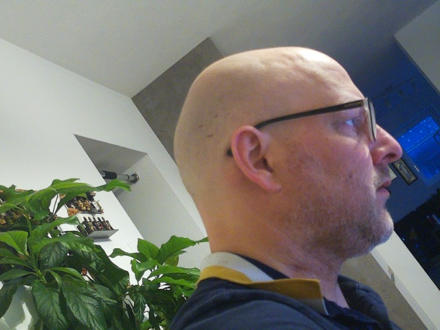

### Ledstrips inside, facing backwards

The LED-Strips are turned on, and inside the housing, but now facing backwards. So only indirect light reflected by the housing is getting through the acrylic glass panel to the target outside. The gray shimmer is still visible, but less strong.

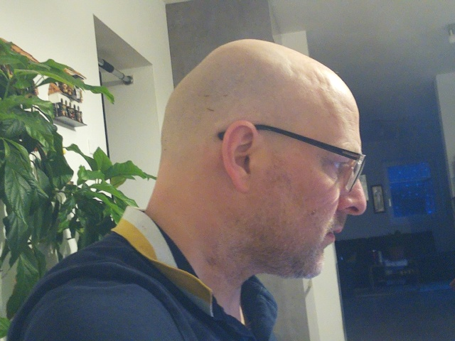

## Second experiment-series in detail

For the second experiment series the LED-strips are always outside of the housing. 

The used target now is imitating the water-meter, which is also covered by a reflecting acrylic glass cover. The target is a sheet of paper and at approximately 1cm distance I put an acrylic glass panel in front of it.

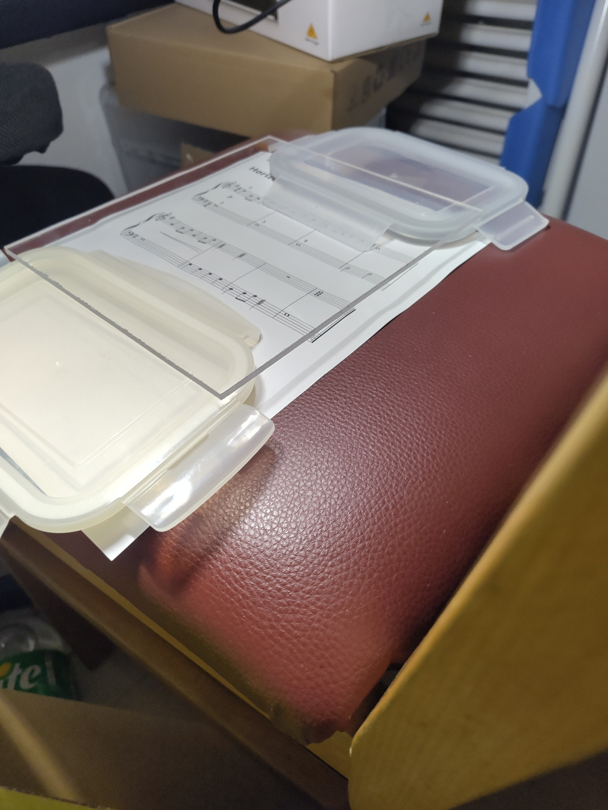

The camera always films this target directly from above.

### Conclusion for this series

Only when the light of the LED-strips hits the target directly but from another "viewing-angle" than the camera, there are no reflections visible in the image. So the LED-strips can't be mounted onto the same housing as the camera.

### LED-Strips on front of the the housing, facing the target

The LED-Strips are mounted on the housing, next to the camera and facing the target directly. There is a strong reflection of the two LED-Strips visible in the image.

Brightness of the LED-Strips is set to 255, which is the maximum brightness.

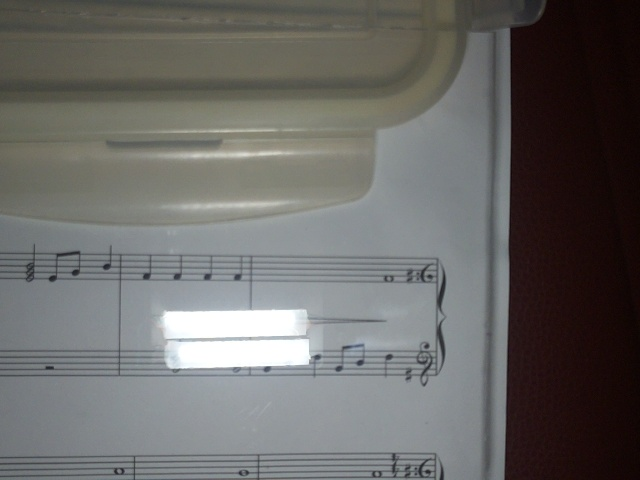

Brightness of the LED-Strips is reduced to 10.

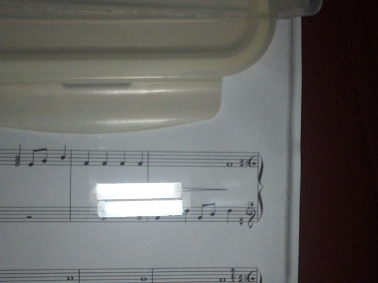

The result is the same. The reduced brightness only blurs the text on the sheet of paper a bit.

## LED-Strips on the front of the housing, facing sidewards

The LED-Strips are mounted like in the previous experiment, but now they are facing sidewards, not towards the target. There are even more reflections, coming from the light housing.

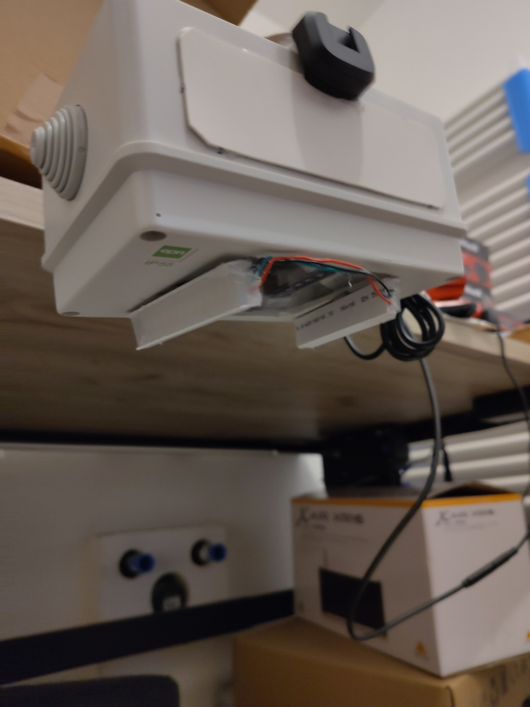

With maximum brightness of the LED-Strips:

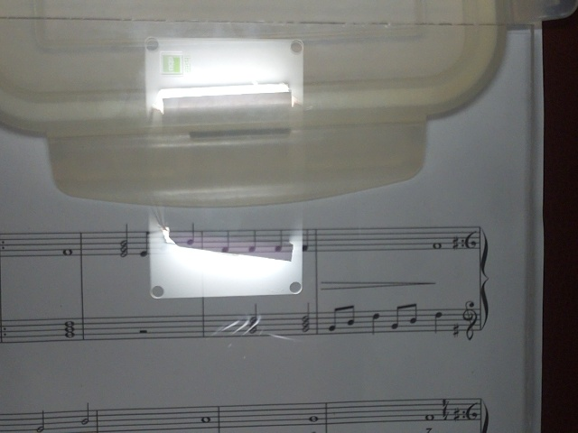

With reduced brightness (10) of the LED-Strips:

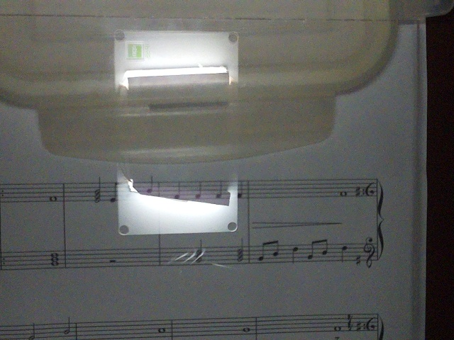

## LED-Strips on the backside of the housing, facing upwards

The LED-Strips are mounted on the backside of the housing, facing upwards. The backside of the housing prevents direct light from the LED-Strips to hit the target. The light is reflected by the ceiling and then hits the target. The problem now is the shadow produced by the housing.

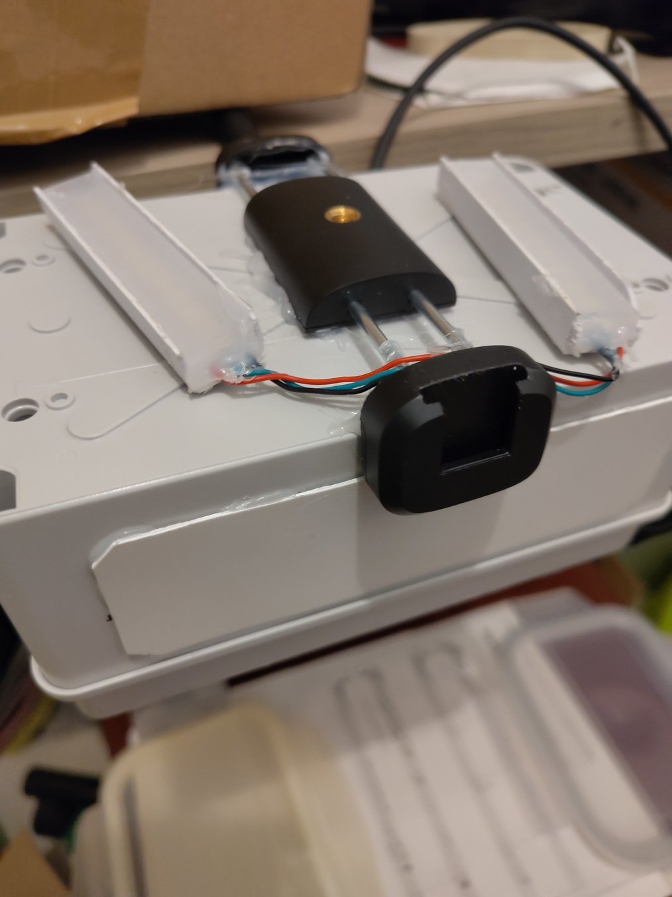

Brightnes is set to 255 (reduced brightness was not tested, because until now there was not diferrence in the results between maximum and reduced brightness):

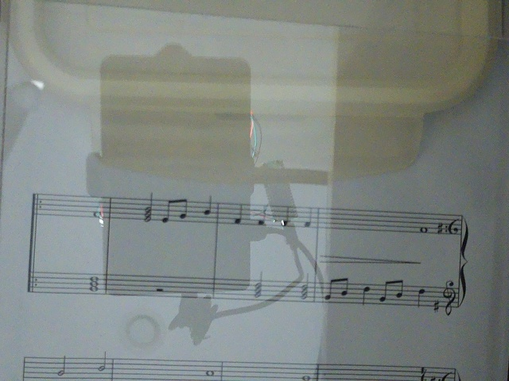

## LED-Strips besides the housing

This is the final configuration: The camera faces the target directly at a distance of about 40cm. The LED-Strips are positionied to the right of the camera, about 30cm away from the camera. They are also facing the target directly. Because of the different angle, there are no reflections visible in the image.

This configuration works.

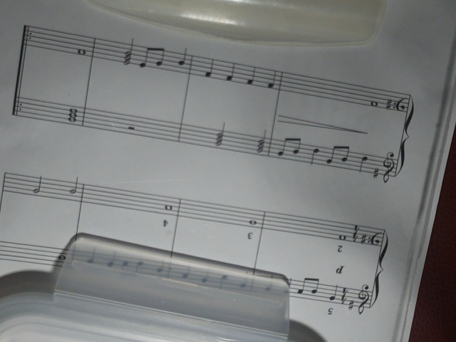